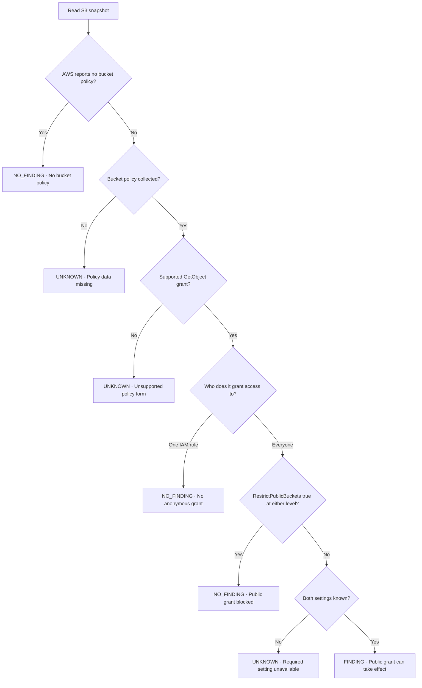

# Cloud Security Case

This prototype checks whether an Amazon S3 bucket policy allows anonymous object reads and whether S3 Block Public Access blocks that grant. It evaluates configuration snapshots locally.

## Proposed checks

| Check | Customer risk and priority |
| --- | --- |
| S3 anonymous object reads | Public access to internal reports, logs, or backups can expose customer data. Prioritize policies that permit reads after accounting for S3 Block Public Access. |
| Unused active IAM access keys | A key left active after a script is retired can still authorize requests if exposed. Prioritize active keys with a long period of inactivity and confirm whether they are still needed. [AWS Security Hub](https://docs.aws.amazon.com/securityhub/latest/userguide/unused-access-findings.html) |
| Cross-account access to Secrets Manager secrets | An outside integration could retain access to a database password or API credential. Prioritize secrets where the relevant identity and secret policies allow reads and the caller can use the KMS key to decrypt. [AWS Secrets Manager](https://docs.aws.amazon.com/secretsmanager/latest/userguide/auth-and-access_examples_cross.html) |

## Run the S3 check

Use Node.js 24.12 or newer. Node runs the TypeScript file directly. No npm dependencies or AWS credentials are required. [Node.js TypeScript support](https://nodejs.org/docs/latest-v24.x/api/typescript.html)

```sh
node scan_s3.mts fixtures/public-read.json
node scan_s3.mts fixtures/account-blocks-public-read.json
node scan_s3.mts fixtures/account-settings-denied.json
node scan_s3.mts fixtures/role-only-read.json
```

The first three fixtures use the same policy and vary the account-level Block Public Access response. The fourth uses the same settings as the finding and replaces the public principal with the IAM role used by the reporting app.

| Fixture | Expected status | Evidence in the output |
| --- | --- | --- |
| [public-read.json](fixtures/public-read.json) | `FINDING` | The policy grants `s3:GetObject` to everyone and both restriction values are false. Remove or narrow the grant. |
| [account-blocks-public-read.json](fixtures/account-blocks-public-read.json) | `NO_FINDING` | The same grant exists and `blocking_levels` identifies the account as the level that blocks it. |
| [account-settings-denied.json](fixtures/account-settings-denied.json) | `UNKNOWN` | The bucket-level setting is false, and the account-level setting is unknown because collection returned `AccessDenied`. |
| [role-only-read.json](fixtures/role-only-read.json) | `NO_FINDING` | Both restriction values are false. `role_read_statement` shows that the policy grants `s3:GetObject` only to the `ReportsApp` IAM role. |

The CLI outputs one JSON result. Exit code 0 means the snapshot was processed. Invalid JSON, an unreadable file, or an invalid snapshot header exits with code 2.

## Run the tests

```sh
node --test scan_s3.test.mts
```

The tests run the CLI against all four fixtures and check the status and evidence for each decision. They also cover absent Block Public Access configuration, bucket-level blocking when account data is unreadable, and role ARN path validation.

## How it works

The scanner recognizes one unconditional `Allow` statement granting `s3:GetObject` across the named bucket. `Action` and `Resource` can each be a string or an array with one value. A grant to one named IAM role yields `NO_FINDING` for anonymous reads. For a public grant, the scanner checks `RestrictPublicBuckets` at the bucket and effective account levels. `BlockPublicPolicy` applies when saving a public policy and leaves existing policies in place. [S3 Block Public Access semantics](https://docs.aws.amazon.com/AmazonS3/latest/userguide/access-control-block-public-access.html)



### Live data sources

A live collector would assume a customer-provisioned read-only role in the bucket owner's account and normalize its responses into the fixture format. The prototype uses the returned policy document as evidence.

| AWS API | IAM permission | Use |
| --- | --- | --- |
| S3 `ListBuckets` | `s3:ListAllMyBuckets` | Inventory buckets owned by the account. |
| S3 `GetBucketPolicy` | `s3:GetBucketPolicy` | Read and decode the policy document. |
| S3 `GetPublicAccessBlock` | `s3:GetBucketPublicAccessBlock` | Read the bucket setting. |
| S3 Control `GetPublicAccessBlock` | `s3:GetAccountPublicAccessBlock` | Read the effective account setting, including inherited organization policy. |

AWS Security Hub control S3.2 provides a baseline to compare against when expanding coverage. It also evaluates ACLs. [API permissions](https://docs.aws.amazon.com/AmazonS3/latest/userguide/using-with-s3-policy-actions.html) · [Effective account settings](https://docs.aws.amazon.com/AmazonS3/latest/API/API_control_GetPublicAccessBlock.html) · [Security Hub S3.2](https://docs.aws.amazon.com/securityhub/latest/userguide/s3-controls.html)

### Assumptions and limits

The supported path is a direct anonymous request to a general-purpose bucket. The checker expects a decoded policy or a collection error plus the two Block Public Access responses. Policies with multiple statements, conditions, explicit denies, or unsupported principal, action, or resource forms produce `UNKNOWN`. Named role principals use an explicit IAM role ARN in the `aws` partition, with no wildcard patterns. A confirmed `NoSuchBucketPolicy` produces `NO_FINDING` for this policy path. An unreadable policy produces `UNKNOWN` with the collection error, if present, and a prompt to check `s3:GetBucketPolicy`.

`NoSuchPublicAccessBlockConfiguration` confirms that the restriction is off at the reported level. The output preserves that code as evidence and still checks the other level. An unreadable policy or an unreadable setting required for the decision yields `UNKNOWN`. [S3 Control API errors](https://docs.aws.amazon.com/AmazonS3/latest/API/API_control_GetPublicAccessBlock.html#API_control_GetPublicAccessBlock_Errors)

The result describes what the collected configuration permits. There is no request for object data. Object-level controls such as SSE-KMS can affect actual reads. ACLs and access point policies can grant access through other paths and are outside the prototype. [S3 access control](https://docs.aws.amazon.com/AmazonS3/latest/userguide/access-control-overview.html)

## Scaling to 3,000 environments

Queue jobs per customer account and use bounded worker concurrency with per-account rate limits. Read the effective account setting once per scan, paginate bucket inventory, and reuse the account setting across bucket checks. Retry throttled and transient requests with backoff and jitter. Record permission failures as coverage gaps. Use idempotent writes keyed by customer, bucket, and check, with timestamps for the last successful evaluation and the latest collection attempt.

Before rollout, integrate read-only collection, compare results with AWS Security Hub in representative test accounts, and measure throttling, scan age, and coverage gaps. Pilot with a small set of accounts to verify onboarding permissions, tenant isolation, and the usefulness of reported evidence.
